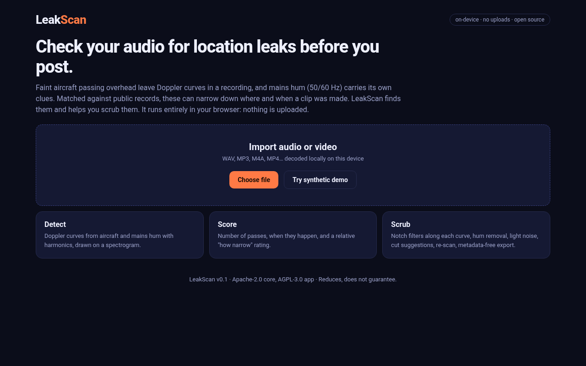
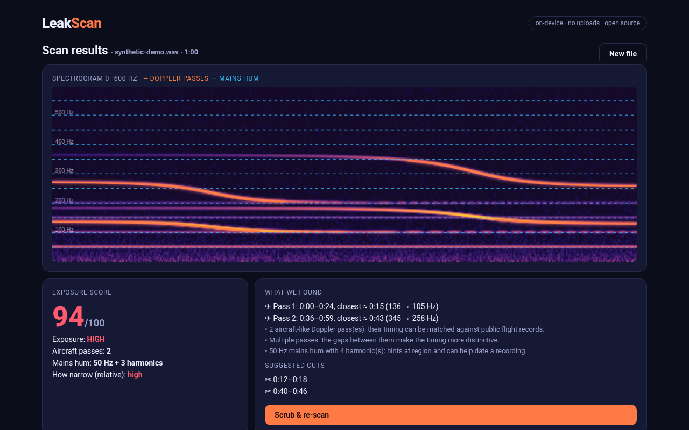
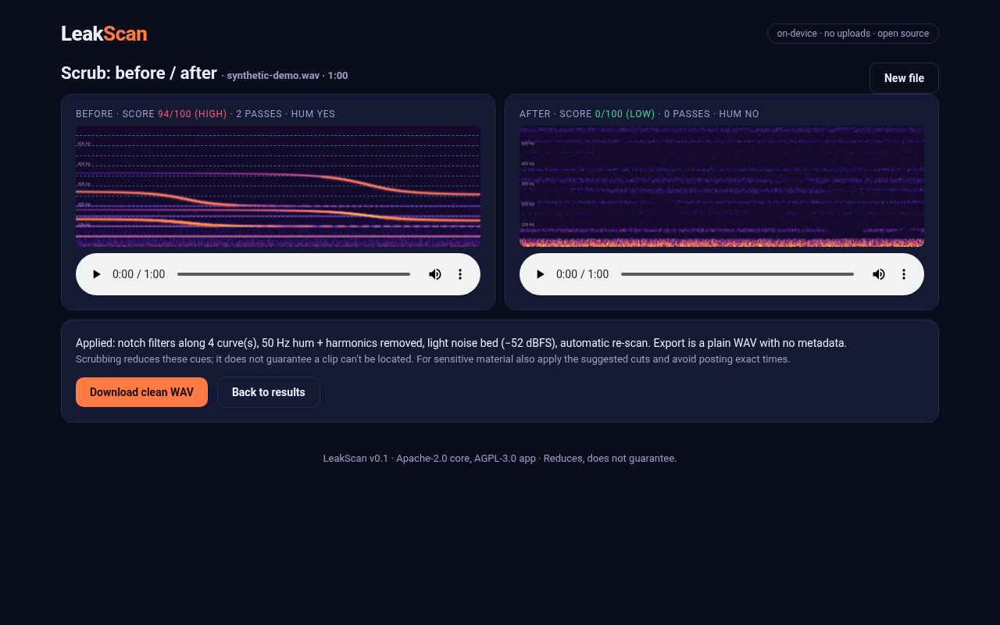

# LeakScan

**Check your audio for location leaks before you post.**

Faint aircraft passing overhead leave Doppler curves in a recording: tonal lines that sweep down as the plane goes by. Mains hum (50/60 Hz and its harmonics) carries clues too. Matched against public records, these cues can help someone narrow down where and when a clip was made, even when nothing in the picture gives it away.

LeakScan is a **defensive** tool. It finds those cues in *your own* audio, tells you how exposed the clip is, and helps you scrub them. Everything runs on your device: no uploads, no accounts, no analytics, no network calls.

**Live web app:** https://detoy.github.io/leakscan/

| Import | Scan results | Scrub before/after |
|---|---|---|
|  |  |  |

> Scrubbing **reduces** these cues; it **does not guarantee** a recording can't be located. See [THREAT_MODEL.md](THREAT_MODEL.md).

## What it does

- **Detect**
  - Finds aircraft-like Doppler passes: narrow tonal ridges that last 2 s or more and sweep down by at least 4%. Harmonics are grouped into one pass.
  - Finds 50 Hz or 60 Hz mains hum and its harmonics. It uses the per-bin median over time, so passing tones don't get counted as hum.
- **Score**
  - Gives a 0–100 exposure score and a low/medium/high level.
  - Lists how many passes there are and when each happens (start, end, closest approach).
  - Gives a *relative* "how narrow" rating (low/moderate/high).
  - It never estimates or outputs a place.
- **Scrub**
  1. Applies spectral notches that follow each detected curve.
  2. Notches out the hum and its harmonics.
  3. Re-scans and re-notches, up to 3 passes.
  4. Adds a light noise bed (−52 dBFS).
  5. Suggests cuts around each pass's closest approach, which also breaks the timing gaps between passes.
  6. Re-scans the result.
  7. Exports a plain 16-bit WAV with only `fmt` and `data` chunks, so no metadata survives.

## What it deliberately does not do

LeakScan has no geolocation, no ADS-B or flight-data lookup or matching, and no maps or coordinates. There is no code that turns detections into a place, and none will be accepted.

## Architecture

```
core/   Rust crate (Apache-2.0): FFT, STFT/ISTFT, ridge tracking, hum detection, scrubbing, synthetic demo signals.
        Built to WASM with wasm-pack (feature "wasm").
app/    Expo app (AGPL-3.0): web today. iOS/Android shells build, but the native core binding is still TODO.
        app/public/core holds the WASM build, loaded from the same origin. Audio is decoded with WebAudio in the browser.
```

The web build is the real Rust core compiled to WASM, not a port.

## Develop

```bash
# core
cd core && cargo test --release                      # unit tests on synthetic signals
cargo run --release --example gen_demo -- demo.wav   # write the synthetic demo clip

# web (needs rustup target wasm32-unknown-unknown + wasm-pack)
./scripts/build-web.sh                               # -> app/dist, served under /leakscan/
cd app && npx expo start --web                       # dev server
```

All demo audio is **synthetic**, generated by `core/src/synth.rs`: two propeller-like passes 27 s apart plus 50 Hz hum over noise. No real recordings are used or shipped.

## Status (v0.1)

- ✅ Rust core with 8 unit tests: detection finds the injected passes and hum, there are no false positives on noise or flat tones, the scrubbed clip re-scans to 0/100, and it works at 16 kHz and 48 kHz.
- ✅ Web app (WASM) with import, scan, highlighted spectrogram, scrub, before/after playback and clean WAV export.
- ⏳ Native iOS/Android: Rust↔React Native bindings (uniffi/JSI) and native audio decode.
- ⏳ Video in, video out (remux the scrubbed audio track). For now video files are decoded to audio only.
- ⏳ More cue types (traffic and tonal machinery), adaptive thresholds, and tests on real-world recordings we made ourselves.

## Credits & licence

Inspired generally by public research and talks about acoustic location cues. Core: Apache-2.0. App: AGPL-3.0. See [LICENSE](LICENSE).
